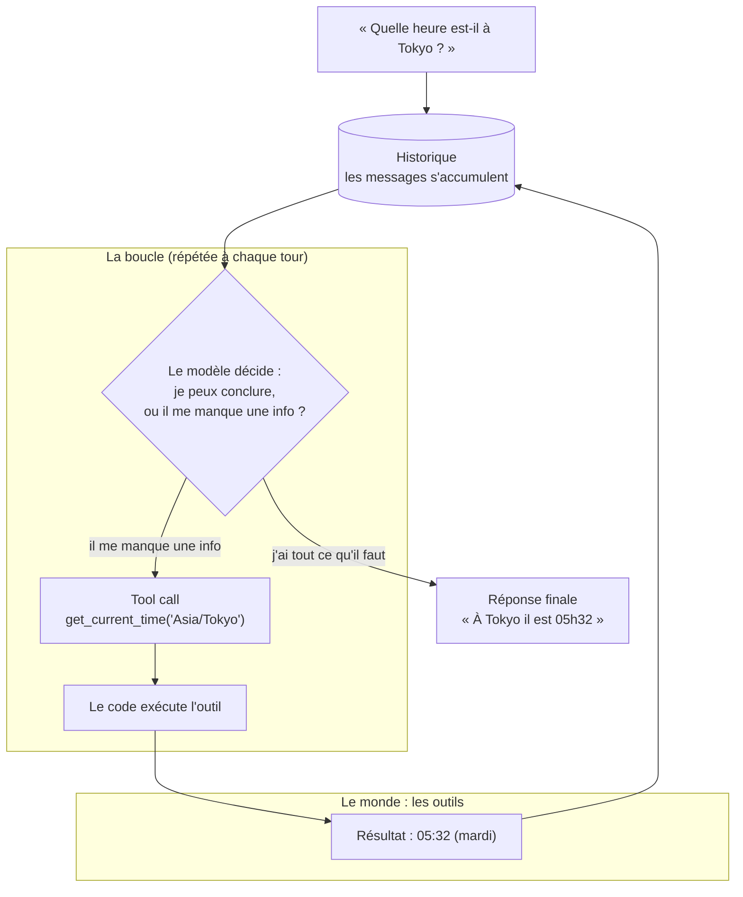

# Qu'est-ce qu'un agent, vraiment ?

« Agent IA » est sans doute l'expression la plus galvaudée de 2026. Tout le monde en
parle, presque personne ne sait ce que ça veut dire. Cet article propose une définition
qui tient debout, et je la prouve avec le plus petit agent possible.

## Le concept

Imagine un type très cultivé, enfermé dans une pièce. Pas de fenêtre, pas de montre, pas
d'internet. Il sait une quantité de choses hallucinante, mais il ne connaît ni l'heure, ni
le temps qu'il fait dehors, ni ce qui se passe en ce moment même.

Ce type, c'est un *LLM*.

Un *chatbot*, c'est ce type en train de discuter à travers la porte. Tu lui parles, il
répond. Une fois. Puis il se tait.

Un *agent*, c'est ce même type, à qui on a ouvert la porte, donné une montre et des mains,
et la permission de se lever pour agir. Il ne répond plus seulement de mémoire : il
consulte ses outils, il agit, il vérifie, et il recommence jusqu'à ce que le boulot soit
fait.

Techniquement, on lui a donné trois choses qu'il n'a pas de base :

| Ingrédient | Ce que ça change |
|------------|------------------|
| Une boucle | Il ne répond plus une seule fois : il enchaîne des étapes jusqu'à un objectif |
| Des outils | Il agit sur le monde (lire l'heure, lancer un script, interroger une API) au lieu de juste générer du texte |
| De la mémoire | Il garde le fil entre chaque tour : contexte, résultats intermédiaires |

La différence qui compte : un chatbot attend ta question. Un agent, lui, est lancé avec un
but, et il recommence tout seul, en décidant à chaque tour s'il a besoin d'un outil ou
s'il peut s'arrêter.

## Use case : le plus petit agent possible

Le cas le plus parlant, c'est celui où le modèle ne peut pas répondre sans outil. Un LLM
a des données d'entraînement figées dans le temps : il ne sait pas l'heure qu'il est. Si
je lui demande « quelle heure est-il à Tokyo ? », il a deux options. Inventer, ou appeler
un outil.

Donc on construit un agent avec un seul outil (`get_current_time`), et on lui pose :

> Quelle heure est-il à Tokyo ? Et à Paris ?

Le but n'est pas la réponse. C'est de voir la boucle tourner.

## Architecture



Ce schéma, c'est tout. Un historique (la mémoire) qui grossit à chaque tour, un modèle
qui décide, et des outils qu'il appelle quand il lui manque une info. La boucle, c'est la
flèche qui repart du résultat vers l'historique : le modèle tourne jusqu'à ce qu'il puisse
conclure. Tout ce qu'on appelle pompeusement « agent », du micro-script ci-dessous jusqu'aux
orchestrateurs multi-agents, n'est qu'une variation sur ce schéma.

## Le code

Voici l'agent complet (~100 lignes, zéro dépendance hors stdlib). Le fichier source est
dans le repo : [`scripts/mini_agent.py`](https://github.com/cedzer0/agente/blob/main/scripts/mini_agent.py).

```python
#!/usr/bin/env python3
"""Mini-agent minimal : un LLM + un outil + une boucle."""
import json
import os
import urllib.request
from datetime import datetime
from zoneinfo import ZoneInfo

# --- 1. L'outil ----------------------------------------------------------
def get_current_time(timezone: str) -> str:
    """Renvoie l'heure actuelle dans le fuseau horaire demandé (ex: Europe/Paris)."""
    return datetime.now(ZoneInfo(timezone)).strftime("%H:%M:%S (%A)")

TOOLS = {
    "get_current_time": {
        "description": "Renvoie l'heure actuelle dans un fuseau horaire (ex: 'Europe/Paris', 'Asia/Tokyo').",
        "call": get_current_time,
    }
}

# --- 2. L'appel au modèle ------------------------------------------------
def call_model(messages: list) -> dict:
    """Appelle un LLM compatible OpenAI et renvoie son message de réponse."""
    req = urllib.request.Request(
        f"{BASE_URL}/chat/completions",
        data=json.dumps({
            "model": MODEL,
            "messages": messages,
            "tools": [{
                "type": "function",
                "function": {
                    "name": name,
                    "description": t["description"],
                    "parameters": {
                        "type": "object",
                        "properties": {"timezone": {"type": "string"}},
                    },
                },
            } for name, t in TOOLS.items()],
            "tool_choice": "auto",
        }).encode(),
        headers={
            "Content-Type": "application/json",
            "Authorization": f"Bearer {API_KEY}",
        },
    )
    with urllib.request.urlopen(req) as r:
        return json.loads(r.read())

# --- 3. La boucle --------------------------------------------------------
def run(question: str, max_turns: int = 6) -> None:
    messages = [{"role": "user", "content": question}]
    for turn in range(1, max_turns + 1):
        resp = call_model(messages)["choices"][0]["message"]
        messages.append(resp)  # on garde tout l'historique

        if resp.get("tool_calls"):
            for tc in resp["tool_calls"]:
                name = tc["function"]["name"]
                args = json.loads(tc["function"]["arguments"])
                print(f"[tour {turn}] le modèle appelle l'outil {name}({args})")
                result = TOOLS[name]["call"](**args)
                messages.append({"role": "tool", "tool_call_id": tc["id"], "content": result})
                print(f"[tour {turn}] résultat de l'outil : {result}")
        else:
            print(f"[tour {turn}] réponse finale : {resp['content']}")
            break

if __name__ == "__main__":
    BASE_URL = os.environ["LLM_BASE_URL"]
    API_KEY = os.environ["LLM_API_KEY"]
    MODEL = os.environ.get("LLM_MODEL", "deepseek/deepseek-v4-pro")
    run("Quelle heure est-il à Tokyo ? Et à Paris ?")
```

Trois choses à voir :

1. L'outil est décrit en texte (`"description"`). C'est comme ça que le modèle sait qu'il
   existe et quand s'en servir. On ne code pas l'outil « dans » le modèle, on le lui
   présente.
2. L'historique est conservé (`messages.append`). Chaque résultat d'outil revient dans le
   contexte du tour suivant. C'est la mémoire.
3. Le modèle décide (`tool_choice: "auto"`). On ne lui impose pas d'appeler l'outil, il
   choisit à chaque tour entre appeler et conclure.

## Résultats

Exécution réelle, avec `deepseek-v4-pro` :

```text
[tour 1] le modèle appelle l'outil get_current_time({'timezone': 'Asia/Tokyo'})
[tour 1] résultat de l'outil : 05:32:08 (Tuesday)
[tour 1] le modèle appelle l'outil get_current_time({'timezone': 'Europe/Paris'})
[tour 1] résultat de l'outil : 22:32:08 (Monday)
[tour 2] réponse finale : À Tokyo, il est 05h32 (mardi). À Paris, il est 22h32 (lundi).
```

Ce qu'il faut voir dans cette trace :

- Le modèle n'a pas répondu direct. Il a d'abord reconnu qu'il lui manquait une info, et
  il a appelé l'outil. Ça, c'est un agent.
- Il a fait deux appels distincts (Tokyo, puis Paris), parce que la question contenait deux
  sous-questions. Personne ne le lui a demandé, la boucle s'est enchaînée seule.
- Ce n'est qu'au tour 2, une fois les deux heures en poche, qu'il a produit la réponse
  finale.

## Ce qu'il faut retenir

> Un agent = un LLM + une boucle + des outils + de la mémoire, lancé vers un objectif.

Un chatbot répond une fois. Un agent agit, regarde le résultat, et recommence jusqu'à ce
que ce soit fini. Le reste (orchestration multi-agents, planification, mémoire à long
terme), c'est de l'extension de cette boucle de base. Pas un concept différent.
