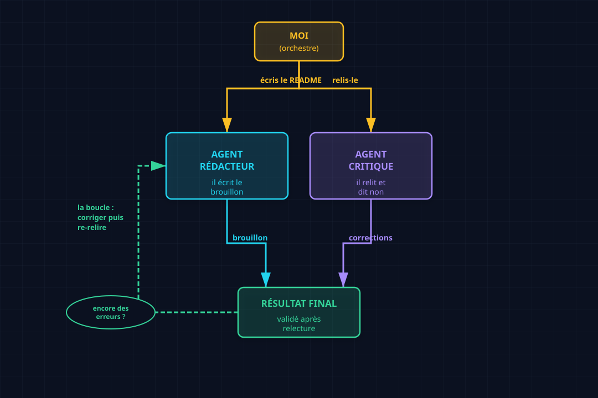

# Multi-agents : quand un agent ne suffit plus

Un agent tout seul fait le boulot, mais le fait *seul*. Il n'a personne pour lui dire
qu'il se trompe. Cet article montre ce qui change quand on en met deux — et pourquoi c'est
souvent la différence entre « ça marche à peu près » et « c'est bon pour de vrai ».

## Le concept

Souviens-toi de l'article 001 : un agent = une boucle + des outils + de la mémoire, lancé
vers un objectif. Le multi-agents, ce n'est **rien d'autre** que plusieurs boucles comme
ça, qui se passent le relais.

Pourquoi en vouloir plusieurs ? Un agent a un défaut de naissance : **il s'auto-valide**.
Il écrit, il se relit, et il a tendance à trouver que tout va bien. C'est le biais du
rédacteur qui signe sans se relire — pas par paresse, mais parce qu'il ne *voit* plus ses
propres erreurs.

La parade la plus simple, c'est de séparer les rôles :

| Rôle | Ce qu'il fait |
|------|---------------|
| **Le producteur** | il écrit, il fabrique, il avance |
| **Le critique** | il relit, il cherche la faille, il dit non |

C'est le **pattern 2-stage** (produire → critiquer), la brique la plus basique du
multi-agents. On n'ajoute pas d'autre modèle, pas d'autre infra : on lance juste deux
agents avec deux missions différentes, et on orchestre la passation entre les deux.

## Use case : un README écrit à deux

Le cas est tout petit, et c'est fait exprès : écrire le README d'un repo. N'importe quelle
IA le fait en dix secondes, alors pourquoi deux agents ?

Parce que l'enjeu n'est pas `README`, c'est `README sans erreur`. Et c'est là qu'un seul
agent se manque : il écrit « sur `main` » sans se rendre compte qu'il manque une étape,
il laisse une faute de grammaire, il oublie un lien.

Donc on monte ça :

1. **Agent rédacteur** : écris le README.
2. **Agent critique** : relis-le, et trouve tout ce qui cloche.
3. Moi, entre les deux : je fais le relais.

## Architecture



Trois acteurs, un seul flux. L'orchestrateur (moi, ou du code) donne la tâche au
rédacteur, récupère le résultat, le tend au critique, et c'est le critique qui décide si
on s'arrête ou si on revient corriger. Le point clé : **le rédacteur ne voit jamais son
propre travail comme fini tant que le critique n'a pas tranché.**

## Le code

Le montage se fait avec `delegate_task`, qui lance un agent dans un contexte isolé (il ne
voit que ce qu'on lui donne, pas notre conversation). Voici l'appel au rédacteur :

```python
delegate_task(tasks=[{
    "context": "Tu es un rédacteur technique. Écris le README de ce repo. "
               "Ton : direct, un peu fun, pas d'écriture IA, pas d'emoji.",
    "goal": "Écrire /chemin/README.md ...",
    "output_schema": {
        "type": "object",
        "properties": {
            "file_path": {"type": "string"},
            "summary": {"type": "string"},
        },
    },
}])
```

Et l'appel au critique, **dans un contexte séparé** — c'est le point crucial : il ne sait
rien de ce qu'a fait le rédacteur, il ne lit que le résultat :

```python
delegate_task(tasks=[{
    "context": "Tu es un relecteur exigeant. Relis /chemin/README.md "
               "et trouve tout ce qui cloche.",
    "goal": "Relire le README et donner un verdict + la liste des problèmes.",
    "output_schema": {
        "type": "object",
        "properties": {
            "verdict": {"type": "string"},
            "issues": {"type": "string"},
        },
    },
}])
```

Ce qu'il faut voir :

1. **`delegate_task`** = l'outil qui fabrique un agent. Chaque appel, c'est une nouvelle
   boucle du 001, avec son objectif à elle.
2. **Le contexte est cloisonné** — le critique ne reçoit *pas* l'historique du rédacteur,
   juste le fichier à relire. C'est ce qui l'empêche d'être contaminé par l'optimisme du
   rédacteur.
3. **`output_schema`** = on force une réponse structurée. L'orchestrateur (moi) sait
   exactement quoi lire à la sortie : `verdict` + `issues`.

## Résultats

Voilà ce que ça a donné, sur un vrai repo :

```text
[rédacteur]  README écrit (~25 lignes) :
             « Je fabrique des agents IA, je les regarde se casser la figure,
              et je note ce que j'apprends. »

[critique]   verdict : À CORRIGER
             1. « titre-du-article » → faute : « du » devant une voyelle.
             2. il manque une étape : ajouter le lien dans le tableau de index.md.
```

Deux erreurs trouvées. La première est une coquille que le rédacteur n'avait pas vue.
La seconde est plus profonde : c'est une **étape manquante dans la procédure**, pas une
faute de frappe — le genre de chose qui ne se voit qu'avec un regard neuf.

Et c'est exactement le gain du multi-agents : **le critique a attrapé ce que le rédacteur,
en s'auto-relisant, était structurellement incapable de voir.** Pas parce que le critique
est plus malin — il tourne sur le même type de modèle — mais parce qu'il arrive *froid*,
sans l'historique de ce qui vient d'être écrit.

## Ce qu'il faut retenir

> **Multi-agents = plusieurs boucles qui se passent le relais, avec des rôles séparés.**

Le pattern le plus simple, et déjà le plus rentable, c'est **produire → critiquer**. Un
agent avance, un autre dit non. Ça ne demande rien de plus que deux appels et une
coordination — mais ça transforme « un agent qui se fait confiance » en « deux agents qui
se vérifient ».

Et au passage, c'est la porte d'entrée vers tout le reste : les essaims, le farming,
l'orchestration complexe — tout ça, c'est la même brique, répétée et câblée différemment.
